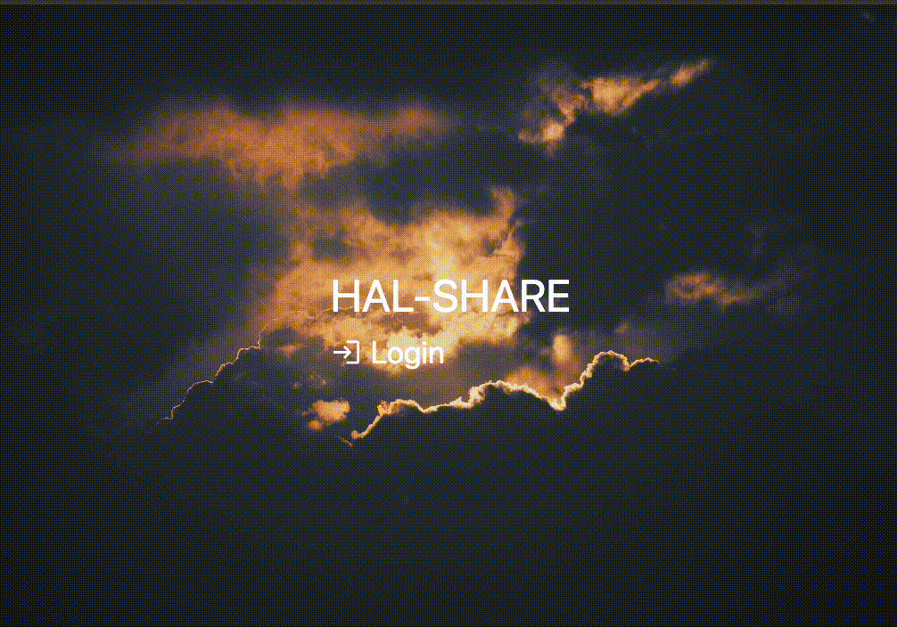
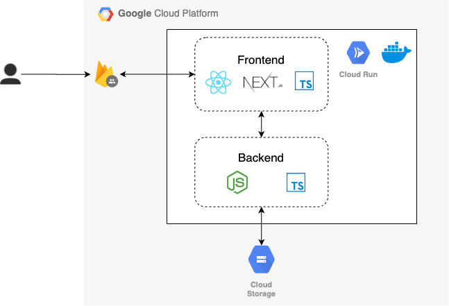

# file-share

限定したプライベートメンバー内で利用可能なクラウドファイルシェアアプリ

## エレベーターピッチ

- `ファイル共有のコストを抑え` たい
- `複数人で活動しているチーム` 向けの、
- `file-share` というアプリは、
- `プライベートメンバー専用のクラウドファイル共有サービス` である。
- これは `許可したメンバーのみにアクセスを限定したファイル共有` ができ、
- `GoogleDriveやDropBox` とは違って、
- `プランや容量を気にせず圧倒的安価でファイルを保管・共有することができる機能` が備わっている。

## 主な機能

- Googleアカウントによるログインと利用許可リストでのアクセス制御
- ファイルのアップロード・ダウンロード・削除
- フォルダによるファイル管理
- 音声ファイルのブラウザ再生

### デモ



## 構成

Next.js / React / TypeScriptで実装し、Cloud Runで動作します。認証にFirebase Authentication、ファイル保存にCloud Storage、プロフィール保存にFirestoreを使用します。

### 技術スタック

- フロントエンド: Next.js / React / TypeScript / Tailwind CSS
- バックエンド: Next.js API Routes / Node.js / TypeScript
- 認証: Firebase Authentication（Googleログイン）
- ファイルストレージ: Google Cloud Storage
- プロフィール管理: Cloud Firestore
- コンテナ・デプロイ: Docker / Google Cloud Run / Artifact Registry

テナントごとの設定・画像は`tenants/<tenant-id>/`で管理します。サンプルは`tenants/dummy/`です。Firebaseの認証基盤は共通利用し、Cloud Runサービス・GCSバケット・実行サービスアカウント・利用許可リストはテナントごとに分けます。



## ローカル起動

Node.js 22以上を使用します。[.env.example](./.env.example)を参考に`.env.local`を設定し、サンプルを起動します。

```bash
npm ci
npm run dev
```

ブラウザで[http://localhost:3000](http://localhost:3000)を開きます。

## デプロイ

事前にGoogle Cloudのレジストリ・Cloud Runサービス・GCSバケット・実行サービスアカウントを用意します。Cloud Runには`BUCKET_NAME`・`ALLOWED_EMAILS`・`FIREBASE_PROJECT_ID`を設定し、実行サービスアカウントへ対象バケットの操作権限と自身の署名権限を付与します。Firebaseの承認済みドメインとGCSのCORSも設定してください。

以下は、構築済みのCloud Runサービスを更新する手順です。Firebaseの公開用設定（`NEXT_PUBLIC_FIREBASE_*`）はビルド前に設定します。実行にはgcloud・Dockerの認証と、対象リソースへの操作権限が必要です。

```bash
export PROJECT_ID="your-project-id"
export REGION="asia-northeast1"
export TENANT_ID="dummy"
export SERVICE="file-share"
export IMAGE="${REGION}-docker.pkg.dev/${PROJECT_ID}/REPOSITORY/${SERVICE}:TAG"

# 対象テナントのイメージをビルド・push
npm ci
npm run image:build -- "$TENANT_ID" "$IMAGE"
docker push "$IMAGE"

# 既存のサービス設定を維持してイメージを更新
gcloud run deploy "$SERVICE" \
  --project="$PROJECT_ID" --region="$REGION" \
  --image="$IMAGE"
```

`TENANT_ID`には`tenants/`内のディレクトリ名を指定します。プロジェクト・サービス・リポジトリ・タグはデプロイ先に合わせて変更してください。更新後、ログインとファイル操作を確認します。
